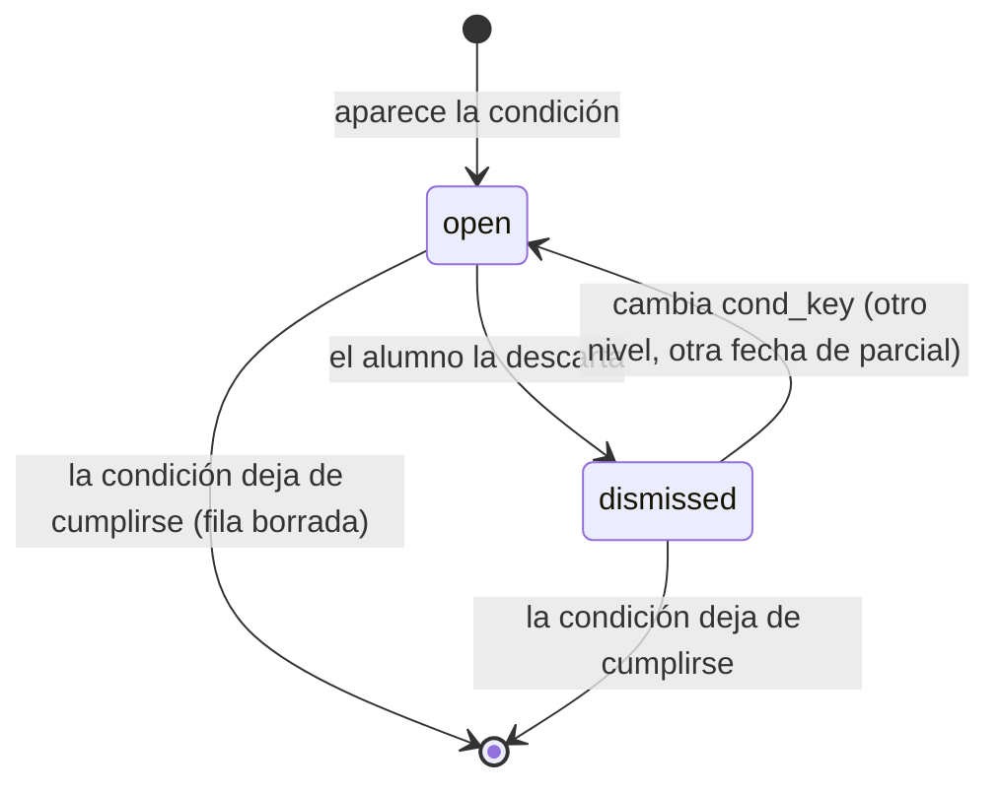

# Alertas dentro de la app

Avisos al alumno cuando deja de estudiar o pasa la fecha de un parcial sin registrarlo, con un botón que lo lleva al tutor. Una alerta abierta sobre una materia seca esa rama del árbol.

## Decision

Las alertas **no tienen cron**: se recalculan y sincronizan con la tabla `alerts` en cada lectura o escritura del árbol (`Server.state` → `syncAlerts`). La tabla existe solo para recordar cuáles descartó el alumno.

Rechazado:
- **Job periódico que genere alertas**: una alerta podría quedar abierta horas después de que el alumno volvió a estudiar. Recalculando al leer, desaparece en el mismo request que la resolvió.
- **Descartar = borrar**: la condición sigue vigente y la alerta volvería en el próximo `GET`. Por eso se guarda `dismissed` junto a `cond_key`.

## Contract

**In/Out:** `GET /api/students/{id}/alerts`, `POST …/alerts/{alert_id}/dismiss`. Tipos, niveles, acciones y umbrales en [contratos §2.3](../../../docs/contratos.md).

**Contrato con la app:** los valores de `type` (`inactivity`, `first_exam_missed`) y `action.type` (`open_tutor`, `build_schedule`, `view_dates`, `contact_tutor`) son lo que la app matchea para dibujar el botón. No se pueden renombrar sin cambiar `web/`.

**Quién más lo lee:** el `dry` de `GET /tree` sale de las alertas abiertas; [`teacher-view`](teacher-view.md) calcula las mismas condiciones sin escribir y muestra también las descartadas.

## Flow

Lo que garantiza este servicio:

- Una fila por `(student_id, type, subject_id)` (índice único). La misma condición descartada no vuelve; una condición nueva del mismo tipo la reabre.
- Solo se escriben las filas que cambian: la mayoría de las lecturas no tocan la tabla.
- Las escrituras toman un advisory lock por alumno (`pg_advisory_xact_lock(1, student_id)`) y recalculan la diferencia adentro. La app pide `/tree` y `/alerts` a la vez, así que dos sincronizaciones simultáneas del mismo alumno son lo normal, no la excepción.
- Una materia aprobada nunca queda seca, aunque tenga alerta.

## When it fails

| Estado | Se cura solo | Quién lo recupera |
|---|---|---|
| Parcial cargado con fecha equivocada dispara `first_exam_missed` | sí, cuando el alumno carga el `exam` con `result` para esa fecha | el alumno |

## Operating

- Umbrales en `internal/tree` (`Thresholds`, `SeasonThresholds`), compartidos con la salud: cambiarlos mueve las dos cosas a la vez.
- Para ver alertas en la demo: `arbol seed` deja a Beto con `inactivity` media y `first_exam_missed` alta.
- Rollback: imagen anterior. Las filas de `alerts` se re-sincronizan solas en la próxima lectura.
