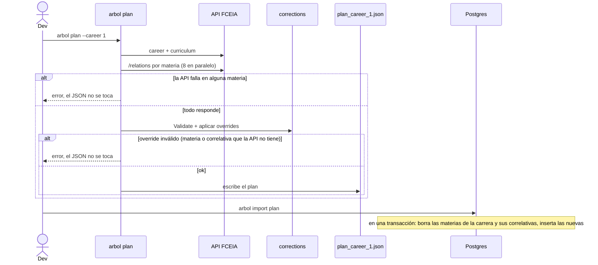

# Plan de la carrera (árbol base)

Convierte las materias y correlativas de la API de la FCEIA en el plan que la app dibuja como árbol: cuellos de botella, camino crítico, holgura y atraso por posponer.

## Decision

El plan se calcula **offline** (`arbol plan`), se versiona como JSON en `backend/data/plan_career_<id>.json` y se importa a Postgres. `GET /api/careers/{career_id}/plan` lee de la base, nunca de la API de la FCEIA.

Rechazado:
- **Calcularlo en cada request desde la API**: la API es de un tercero, lenta (una llamada a `/relations` por materia) y sin SLA. Si se cae, el árbol de todos los alumnos se caería con ella.
- **Usar el `year` de la API**: tiene errores; todo se deriva de las correlativas (ver [camino-critico](../../../docs/camino-critico.md)).

El costo: un cambio en la API o en `corrections/` no llega a los alumnos hasta regenerar el JSON y volver a importarlo.

## Contract

**Out:** `GET /api/careers/{career_id}/plan` y `GET /api/faculties`, públicos y cacheables. Forma en [contratos §2.1 y §2.4](../../../docs/contratos.md).

**Depende de:** la capa de revisión manual de [`corrections`](../../../corrections/docs/features/manual-review.md). `fceia` (`prerequisites`, `build_schedule`) aplica la misma; si una de las dos se actualiza sin la otra, el árbol y el tutor muestran correlativas distintas.

**Invariante que la app asume:** `bottleneck` es `unlocks_total >= 8`; `requires` y `unlocks` son solo las correlativas directas; la Tesina es una materia más de `subjects`.

## Flow

Lo que garantiza este servicio:

- El import es todo o nada y se puede repetir: reemplaza las materias de esa carrera, deja la fila de `careers` (los alumnos la referencian).
- `student_subjects` no tiene FK a `subjects`: re-importar no borra el estado de ningún alumno. Si una materia desaparece del plan, su estado queda huérfano y no se dibuja.
- Las tablas del plan van con clave `(faculty, id)`: otra facultad no choca con los ids de la FCEIA.

## When it fails

| Estado | Se cura solo | Quién lo recupera |
|---|---|---|
| `arbol plan` falla (API caída o override inválido) | no, pero no rompe nada: el JSON anterior sigue | quien regenera, al reintentar o corregir `corrections/data/` |
| JSON regenerado pero no importado | no | quien despliega: `arbol import plan` (o `make up`, que importa siempre) |
| Carrera sin plan importado | no, `GET /api/faculties` no la lista y no se puede elegir en el onboarding | `arbol import plan --file …` |

## Operating

- Regenerar: `arbol plan` (`--career`, `--overrides` para probar otra revisión, `--out`). Importar: `arbol import plan`. `make up` importa en cada arranque.
- La imagen Docker copia `backend/data/`: un JSON nuevo requiere una imagen nueva o correr el import con `--file`.
- Rollback: re-importar el JSON anterior (`git show <rev>:backend/data/plan_career_1.json`). No hace falta rollback de imagen.
