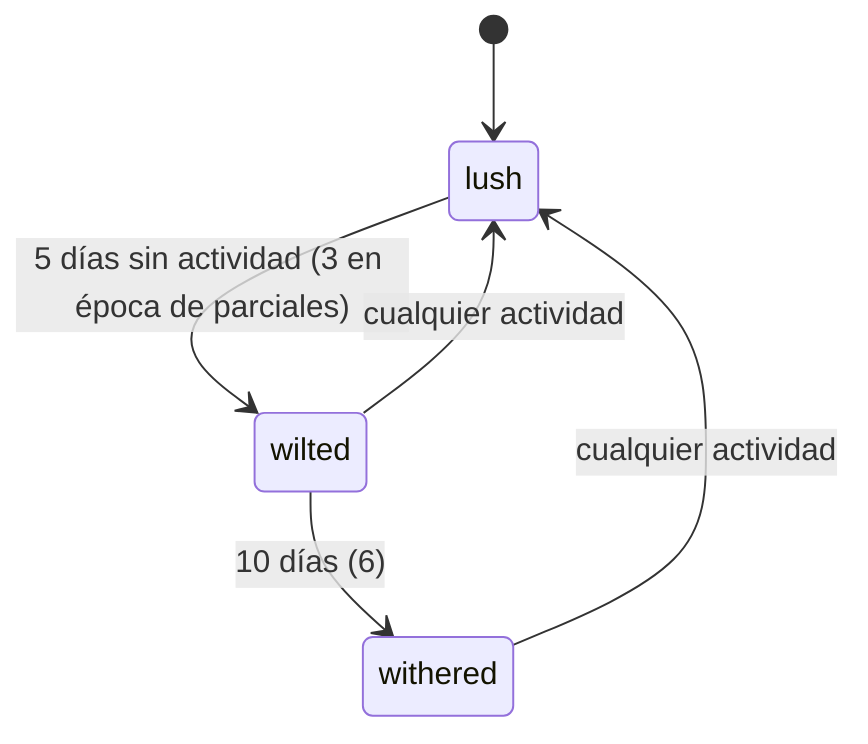

# Estado del alumno: árbol, salud y racha

El árbol de cada alumno sobre el plan de su carrera: qué materias tiene aprobadas, regulares o cursando, cuánto practicó (hojas y flores), si el árbol está frondoso, mustio o marchito y su racha semanal.

## Decision

**No se guarda ningún estado derivado.** Salud, racha, comodines, hojas, flor y materias disponibles se recalculan en cada lectura (`tree.Build`, puro) desde tres cosas guardadas: el estado de cada materia, las actividades y los períodos del calendario.

Rechazado:
- **Guardar salud y racha en columnas y actualizarlas con un cron**: la racha depende de semanas ISO, receso y comodines; con un cron, cualquier ajuste de reglas dejaría datos viejos mal calculados. Recalcular hace que un cambio de umbral aplique retroactivamente sin migración.
- **Un "puntaje de abandono"**: a propósito, el contrato solo expone estados y alertas, nunca un número sobre el alumno.

El costo: cada `GET /tree` lee todas las actividades del alumno. Con el volumen de la hackatón no importa; si crece, el primer lugar a mirar es `db.TreeInput`.

## Contract

**In/Out:** `GET /api/students/{id}/tree`, `PUT …/subjects`, `PUT …/subjects/{subject_id}`, `POST …/activity`; las tres escrituras devuelven el árbol actualizado. Forma, umbrales de salud y reglas de racha en [contratos §2.2 y §2.4](../../../docs/contratos.md); los valores viven en `internal/tree` (`Thresholds`, `SeasonThresholds`).

**Quién más depende de estas reglas:**
- [`alerts`](alerts.md) y [`reminders`](reminders.md) usan los mismos días de inactividad y la misma racha (`tree.Input`).
- [`teacher-view`](teacher-view.md) muestra la salud de cada alumno: cambiar un umbral cambia lo que ve el docente.
- El modo demo de la app (`web/src/mock/mockApi.ts`) copia los umbrales 5/10 a mano; no se actualiza solo.

**Depende de:** la tabla `periods`, cargada a mano desde `backend/data/periods_fceia_2026.json` (la API de la FCEIA no trae receso ni mesas).

## Flow

Lo que garantiza este servicio:

- Cualquier `POST /activity` y cualquier mensaje de chat cuentan como actividad; un `GET` nunca.
- Los días de receso no cuentan para la inactividad y congelan la racha.
- `PUT /subjects` es todo o nada: una materia ajena a la carrera devuelve `404` y no se guarda ninguna.
- Bajar una materia de `approved` está permitido (corregir errores de carga).
- `student_subjects.since` solo se mueve cuando el estado cambia de verdad (`db.UpsertSubjectStates`); los recordatorios `final_pending` y `subject_idle` cuentan desde ahí.
- Nunca hay árbol "muerto": el peor estado es `withered`.

## When it fails

| Estado | Se cura solo | Quién lo recupera |
|---|---|---|
| Postgres caído | sí, al volver la base | nadie; mientras tanto `500 internal` |
| Períodos del año siguiente sin cargar | no: receso y mesas dejan de existir y la salud se calcula como si no hubiera receso | operador, cargando el JSON del nuevo calendario y `arbol import periods` |
| Alumno cargó mal una materia | sí, él mismo la corrige desde la app | nadie |

## Operating

- `arbol import periods` reemplaza todos los períodos de la facultad en una transacción. `periods_fceia_2026.json` cubre el ciclo 2026-27: hay que renovarlo antes de que termine.
- `arbol seed` (re)crea a Ana (frondosa) y Beto (marchito, rama seca) con fechas relativas a hoy; los `student_id` cambian en cada corrida.
- Rollback: imagen anterior. Como no hay estado derivado guardado, volver atrás reglas no deja datos inconsistentes.
