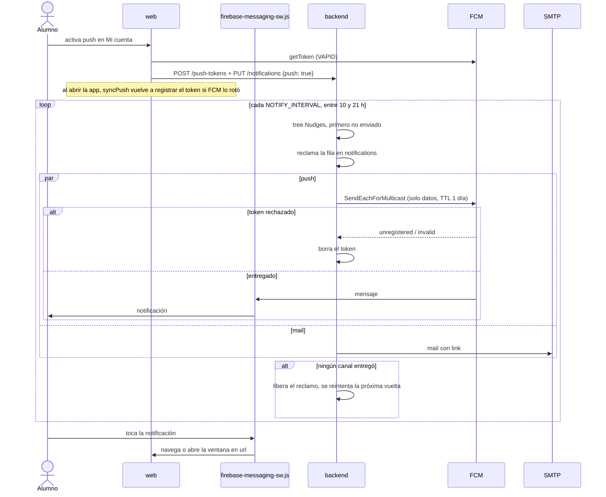

# Recordatorios

Desde que la app registra el navegador para recibir push hasta que el alumno toca el aviso y abre la app. Tres partes: backend, Firebase Cloud Messaging y el service worker de la app; el mail sale directo por SMTP.

## What each service does

- **backend**: decide qué recordatorio, a quién y cuándo; registra lo enviado.
  → [backend/docs/features/reminders.md](../features/reminders.md)
- **web**: pide permiso, registra y rota el token, muestra el push con la app abierta (`onMessage`) y en segundo plano (service worker).
  → [web/docs/features/push-opt-in.md](../../../web/docs/features/push-opt-in.md)
- **Firebase Cloud Messaging**: externo. Entrega al navegador y avisa qué tokens ya no sirven.

## Rules between services

- El mensaje es solo de datos: `title`, `body`, `url`. El service worker no muestra nada si cambian esas claves.
- `url` es absoluta, con base `APP_URL` del backend. Tiene que ser el origen donde está registrado el service worker, si no el click abre una ventana nueva en vez de reusar la app.
- Un token pertenece al último alumno que lo registró. Cerrar sesión en la app lo borra del backend y de FCM (`disablePush`).
- Las rutas de `url` (`/tutor?subject=<id>`, `/schedule`, `/account`) tienen que existir en `web/src/App.tsx`; una ruta que no existe cae en `/` sin error.

## Where it gets stuck

| Estado | Se cura solo | Quién lo recupera |
|---|---|---|
| Token rotado por FCM y la app no se abrió desde entonces | no hasta que el alumno abra la app (`syncPush`); los push a ese navegador fallan y el token viejo se borra | el alumno, abriendo la app |
| El alumno bloqueó las notificaciones en el navegador después de activarlas | no: backend cree que el push está activo y FCM sigue aceptando | el alumno, desde el navegador; el mail sigue llegando |
| Push entregado a FCM pero el navegador estaba cerrado más de un día | no: el TTL lo descarta y backend lo cuenta como enviado | nadie, el próximo aviso es otro día |

Los estados que solo dependen de backend (SMTP caído, canales sin configurar) están en [backend/docs/features/reminders.md](../features/reminders.md).
