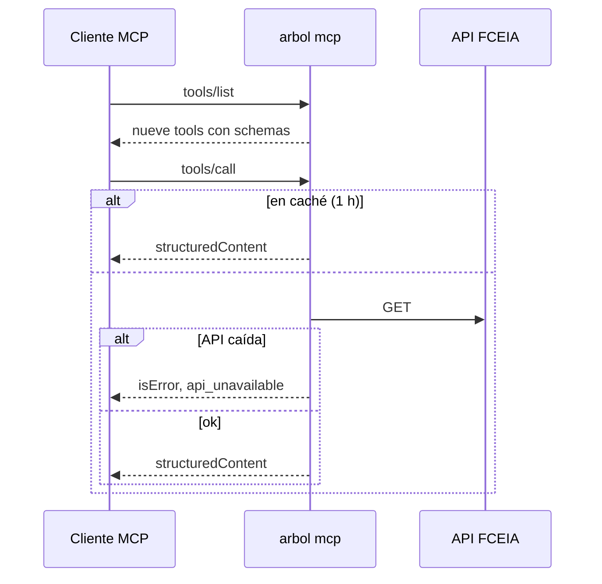

# Servidor MCP de la FCEIA

`arbol mcp` publica las [tools de la FCEIA](fceia-tools.md) como servidor MCP, para que un alumno las use desde su propio cliente (Claude Desktop, Claude Code, el inspector de MCP).

## Decision

El servidor MCP es **solo para clientes externos**. El tutor de Árbol no lo usa: llama a las mismas tools en proceso.

Rechazado:
- **Que el tutor hable con el MCP por red**: un salto más que se puede caer, sin nada que ganar; además el servidor no tiene auth y no conoce al alumno.
- **Tools que escriban** (`record_progress`, `view_my_tree`): no están en el MCP, porque necesitan al alumno autenticado. Viven en el backend.

## Contract

**Out:** Streamable HTTP en `/mcp` y `/health` (devuelve `ok`), o stdio con `--stdio`. Servidor `fceia-mcp`. Las tools devuelven `structuredContent` con su JSON y, si fallan, `isError: true` con `{"error":{"code","message"}}` (no un error de protocolo).

**Sin auth y solo lectura**: expone lo mismo que la API pública de la FCEIA.

## Flow

## When it fails

| Estado | Se cura solo | Quién lo recupera |
|---|---|---|
| API de la FCEIA caída | sí, al volver | nadie; el cliente ve `api_unavailable` |
| Puerto ocupado por la API | no: `arbol mcp` no arranca | quien lo levanta; usa `MCP_PORT`, no `PORT`, justamente para convivir con `arbol serve` |

## Operating

- Local: `make mcp` (HTTP, puerto 8080) o `make mcp-stdio`. En Claude Code: `claude mcp add fceia -- go run ./cmd/arbol mcp --stdio` desde `backend/`.
- Docker: `docker run -p 8080:8080 arbol mcp`.
- Rollback: imagen anterior; no hay estado.
