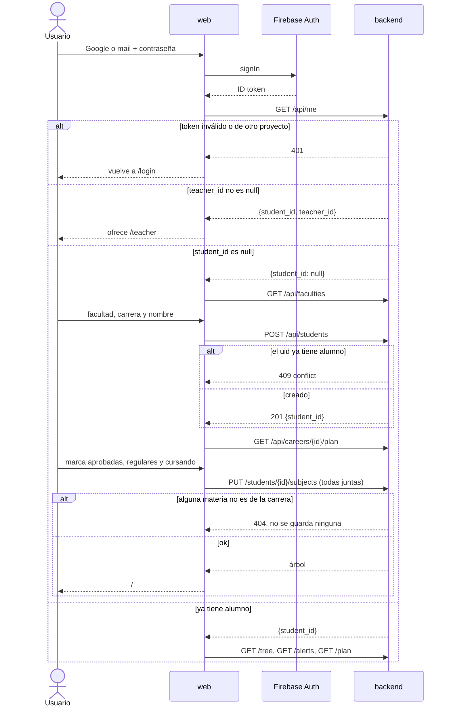

# Login y onboarding

Desde el login con Firebase hasta ver el árbol propio (o la vista docente). Todo síncrono, iniciado por la app.

## What each service does

- **web**: login, pasos del onboarding (`/start`), caché del usuario y su árbol.
  → no escrito (las pantallas no tienen decisiones propias más allá de este flow)
- **Firebase Auth**: externo. Emite y renueva el ID token. Un docente necesita el mail verificado.
- **backend**: vincula el `uid` a un alumno, reconoce docentes por mail verificado.
  → [backend/docs/features/auth-and-students.md](../../../backend/docs/features/auth-and-students.md)

## Rules between services

- La app y backend tienen que usar el mismo proyecto de Firebase (`VITE_FIREBASE_PROJECT_ID` = `FIREBASE_PROJECT_ID`).
- Si el onboarding se corta después de `POST /api/students`, al volver `GET /api/me` ya trae el alumno y la app no pasa de nuevo por `/start`; las materias se marcan después desde el árbol.
- Un docente se reconoce solo con `email_verified`: con mail + contraseña tiene que verificar el mail antes, y recién ahí `/api/me` trae `teacher_id`.
- Al cambiar de usuario, la app borra todo el caché de TanStack Query: nada de un alumno se ve en la sesión de otro.

## Where it gets stuck

| Estado | Se cura solo | Quién lo recupera |
|---|---|---|
| Alumno creado, materias sin cargar | no, pero el árbol funciona (todo `available` o `locked`) | el alumno, marcando materias desde la ficha |
| Docente con mail sin verificar | no, entra como alumno | el docente, verificando el mail desde Mi cuenta |
