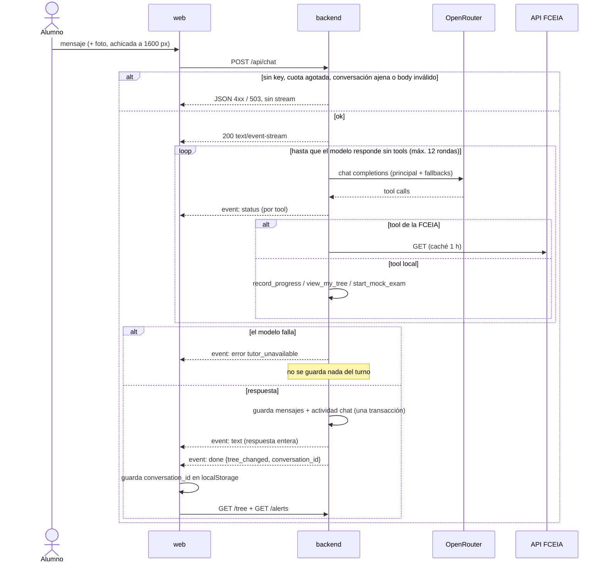

# Chat con el tutor

Desde que el alumno manda un mensaje hasta que ve la respuesta y su árbol refleja lo que registró el tutor. Un request HTTP sostenido como SSE; nada en cola.

## What each service does

- **web**: arma el mensaje, lee el stream con `fetch` (no `EventSource`, que no admite `POST`), simula el tipeo y guarda la lista de conversaciones en el navegador.
  → [web/docs/features/tutor-chat.md](../features/tutor-chat.md)
- **backend**: dueño del turno, las tools, los límites y el historial.
  → [backend/docs/features/tutor-chat.md](../../../backend/docs/features/tutor-chat.md)
- **OpenRouter**: externo. Elige entre el modelo principal y los fallbacks.
- **API FCEIA**: externa, solo lectura, a través de `fceia/tools`.
  → [fceia/docs/features/fceia-tools.md](../../../fceia/docs/features/fceia-tools.md)

## Rules between services

- `done` llega siempre una vez al final de un turno exitoso; `error` lo reemplaza si algo falla. La app cierra el mensaje con cualquiera de los dos.
- `tree_changed` hoy es siempre `true` (todo mensaje cuenta como actividad): la app vuelve a pedir árbol y alertas después de cada turno.
- El turno es atómico en backend: o quedan el mensaje del alumno, la respuesta y la actividad, o no queda nada. Un reintento desde la app no duplica.
- Lo que el tutor registra (`record_progress`) se guarda en el momento de la tool, antes del final del turno. Si después el modelo falla, el progreso queda y el mensaje no.
- La foto viaja al modelo pero no se guarda: al recargar la conversación la app muestra un texto en su lugar.

## Where it gets stuck

| Estado | Se cura solo | Quién lo recupera |
|---|---|---|
| El alumno cierra la pestaña a mitad del turno | sí: el contexto se cancela, no se guarda el turno; lo que ya registró `record_progress` queda | nadie |
| `record_progress` guardó y el turno falló | no se deshace: el árbol muestra progreso que el chat no menciona | nadie; es progreso real del alumno |
| Lista de conversaciones solo en `localStorage` | no: en otro navegador o tras limpiar datos, las conversaciones existen en backend pero la app no las lista | falta `GET /api/students/{id}/conversations` en backend |
